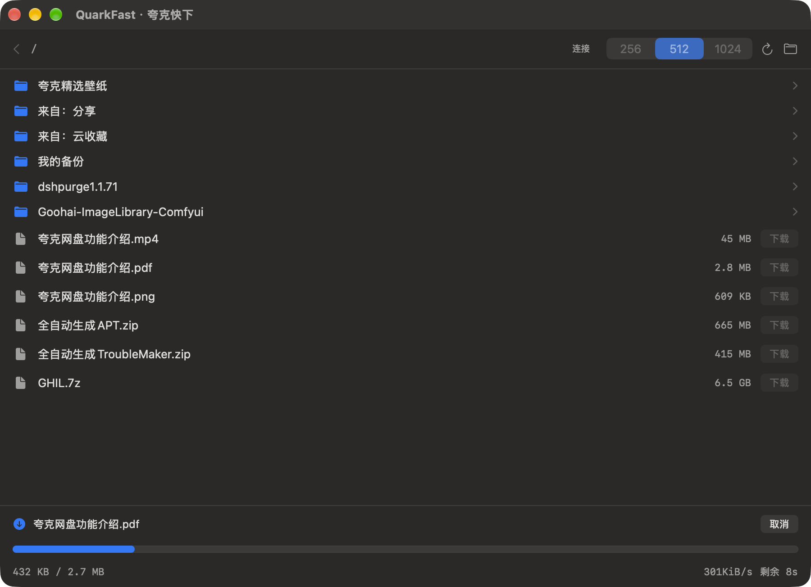

# QuarkFast · 夸克快下

macOS 原生小应用（SwiftUI），用来把**你自己夸克网盘**里的文件下到接近满速。
不是网盘客户端，不碰别人的分享链接，只做一件事：**取直链 + 多连接下载**。



## 为什么快

夸克对非会员是按「**每个连接**」限速，实测每条约 10 KB/s。浏览器只用几个连接，所以你看到几十 KB/s。
把连接数拉到几百条，速度就线性叠上去（本机实测，同一份 6.53 GB 文件）：

| 连接数 | 实测速度 | 下完 6.5 GB |
|---|---|---|
| 1 | 0.04 MB/s | 45 小时 |
| 16 | 0.15 MB/s | 12 小时 |
| 64 | 0.62 MB/s | 3 小时 |
| 128 | 1.14 MB/s | 1.6 小时 |
| 256 | 2.2 MB/s | 48 分钟 |
| **512** | **3.5 MB/s** | **30 分钟** |
| 1024 | 2.6 MB/s | 42 分钟（反而更差） |

所以默认 **512**。再往上会被 CDN 压，也没必要。

## 用起来

### 1. 装

从 [Releases](../../releases) 下载 `QuarkFast.app.zip`，解压拖进 `/Applications`。
首次打开若被 Gatekeeper 拦：右键 → 打开。

或者自己编译（需要 Xcode Command Line Tools，`xcode-select --install`）：

```bash
git clone https://github.com/fage45029704-lgtm/quark-fast-mac.git
cd quark-fast-mac
./build.sh                 # 产出 build/QuarkFast.app
cp -R build/QuarkFast.app /Applications/
```

### 2. 登录一次

应用要读你的网盘，得先有网页登录态（Cookie 里的 `__puus`）。

```bash
python3 cli/login.py
```

会弹出一个**独立的 Chrome 窗口**打开夸克网盘，用手机夸克 App 扫码登录即可。
登录成功后它自动把 Cookie 写进 `~/.config/quark-fast/cookie.txt`（权限 600）并关窗口。

> 这个 Cookie 只存在你本机，应用只发请求给 `drive.quark.cn` 和夸克 CDN，不经任何第三方服务器。

### 3. 下载

打开 QuarkFast：

- 单击文件夹进入，左上角 `‹` 返回
- 双击文件（或点右边「下载」）开始
- 顶部可切换 256 / 512 / 1024 连接
- 底部显示进度、速度、剩余时间，可取消
- 下载目录：`~/Downloads/quark`（右上角文件夹按钮直达）

断点续传是默认的：中断后重新点一次即可，直链过期会自动重取。

## 卸载

```bash
./uninstall.sh
```

等价于删掉这三样（下载的文件不动）：

```
/Applications/QuarkFast.app
~/.config/quark-fast          # 登录态
~/Library/Logs/QuarkFast.log
```

## 命令行版（可选）

`cli/` 里是同一套能力的命令行实现，不想开 GUI 时用：

```bash
python3 cli/quark_dl.py ls /                 # 列目录
python3 cli/quark_dl.py link "/电影/x.mkv"    # 只取直链（可粘进 Motrix/IDM）
python3 cli/quark_dl.py dl "/电影/x.mkv" -j 512
bash cli/dl.sh -t "<直链>"                    # 诊断限速类型
```

## 结构

```
Sources/          SwiftUI 界面 + 进程调用
Resources/        quark_dl.py（后端，零第三方依赖，只用 urllib）
cli/              命令行版 + 登录脚本
build.sh          编译 & 打包 .app
make_icon.swift   生成图标
uninstall.sh      干净卸载
```

后端逻辑很短：`/file/sort` 列目录 → `/file/download` 拿带签名的直链 →
交给 aria2c（用 Motrix 或系统里任意一份）多连接拉。直链签名绑定取链时的 Cookie，
所以应用会把 Cookie / Referer / 客户端 UA 一起写进临时配置（0600），不落命令行。

## 注意

- 只适用于**自己网盘里**的文件；分享链接需要先转存到自己的网盘。
- 直链有效期有限（几小时），过期后重新点下载会重取并续传。
- 账号级限速（整号固定上限）多连接也突破不了——但夸克目前不是这种。
- 别把带签名的直链贴到公开场合。
